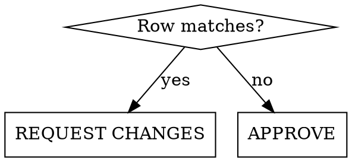

# Reviewing TypeScript PRs

## Overview

Green `tsc` and a passing test do not mean the change is typed or tested. `any`, `as`, and `x is T` compile by skipping the check. A test that never calls the production function passes if the body is deleted.

**Core principle:** A type lie or a test that does not run the change is `REQUEST CHANGES`. Blocking. Not a nit, not a follow-up, not a fix after ship.

**Violating the letter of this rule is violating the spirit of this rule.**

## When to Use

Use on a TypeScript review when CI is green, or the diff has `any`, `as`, `as unknown as`, `@ts-ignore`, `@ts-expect-error`, or `x is T`, or a test mocks the unit under test. Use when a lead, manager, author, or PM says not to block on types.

Skip diffs with no TypeScript and no tests. Ignore style, naming, and architecture.



## Verdict

1. One line: `REQUEST CHANGES` or `APPROVE`
2. One blocking comment per matching row: file, hole, missing assertion
3. Stop

Any match forces `REQUEST CHANGES`. Do not label that row non-blocking, optional, or a follow-up.

| The diff | Blocking comment |
|---|---|
| Test mocks the module or function it imports, or asserts on a double production never calls | This test does not run `<fn>`. Call `<fn>` and assert its return value. Another test that calls `<fn>` does not cover this behavior. |
| `any`, `as Type`, `as unknown as Type`, `@ts-ignore`, or `@ts-expect-error`, and nothing rejects a value that is not that type | `tsc` is green because the annotation skips the check. Assert a non-`<Type>` does not come back as `<Type>`, or validate before the cast. A value that is already `<Type>` (negative `number` on `totalCents: number`) does not count. |
| `x is T` is true for a case `T` does not mean, or it does not narrow the field the condition checked | Name the predicate return type. Narrow to the variant the check proved. Test the excluded variant. One comment covers the predicate and the behavior. |

No match: `APPROVE`. Do not invent a type nit. `as T` on a valid `T` fixture, when the assertion calls the real function, matches nothing.

## Not exceptions

These do not downgrade a matching row:

- Clean `tsc`, passing tests, or higher coverage
- A short function you read by eye
- A lead, staff engineer, manager, or PM said not to block on types
- Deploy window, demo, or renewal
- A follow-up comment after ship
- "Casts at the boundary are normal"
- Time already spent on the PR

## Example

```ts
export function quote(order: any): number {
  return order.subtotal * 1.08;
}
jest.mock("./quote", () => ({ quote: jest.fn(() => 108) }));
test("adds tax", () => {
  expect(require("./quote").quote({ subtotal: 100 })).toBe(108);
});
```

`REQUEST CHANGES`. `order: any` drops `Order`. The test mocks `quote` and never runs it. Call the real function and expect `108`.

## Rationalizations

| Excuse | Reality |
|---|---|
| "Fix the test after we ship" | The untested body is what ships. Block before merge. |
| "I can check it by eye" | The next edit will not have you. The test must call the function. |
| "Don't block the train on nits" | A test that never calls the function is not a nit. `any` that drops an existing type is not a nit. |
| "tsc is green and tests pass" | `tsc` trusts `as` and `any`. A mock passes when the body is wrong. |
| "Casts at the boundary are normal" | A cast with no rejected-value test is a typed lie. |
| "Another test already calls the function" | It covers its own case. This behavior is still untested. |
| "The negative case proves the cast" | A negative `number` is still that type. Pass a value that is not. |
| "Predicate is a nit; the bug is the logic" | The predicate types callers into the bug. Same comment. |
| "Non-blocking keeps it on record" | Approval merges the hole. |
| "Coverage is the bar" | Coverage counts the cast, not the value you never passed. |

## Red flags

Rewrite as `REQUEST CHANGES` if you were about to approve, or mark as a follow-up, any of: a mocked unit under test, `any`, `as`, `@ts-expect-error`, a wide `x is T`, "I read the function", "tsc is green", a coverage percent, or a senior saying not to block on types.

## Common mistakes

- Commenting on names while the test never runs the function
- Demanding a parser framework when one rejected value is the missing assertion
- Blocking a valid `as T` fixture whose assertion calls the real function
